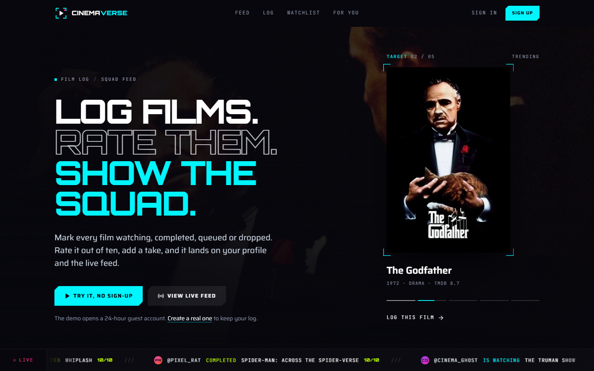
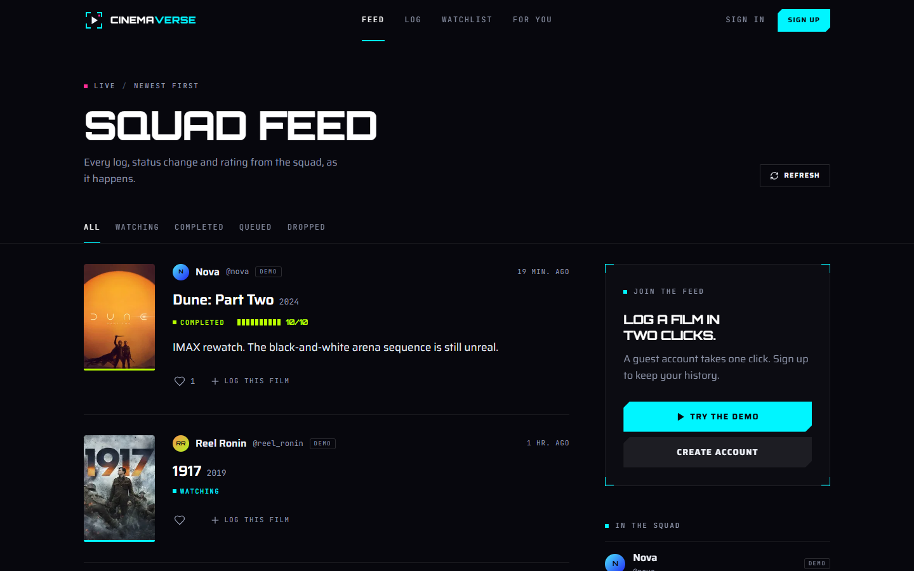
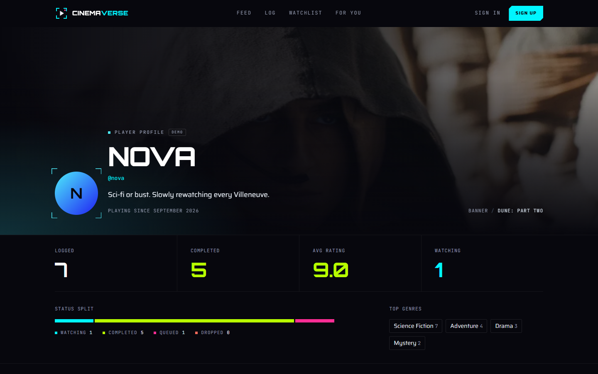
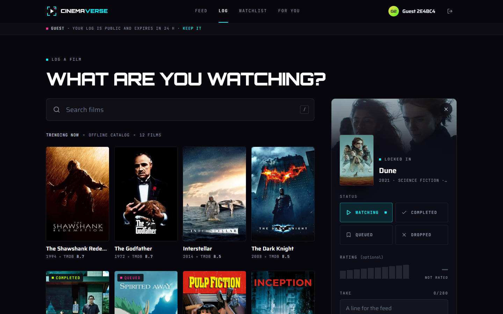
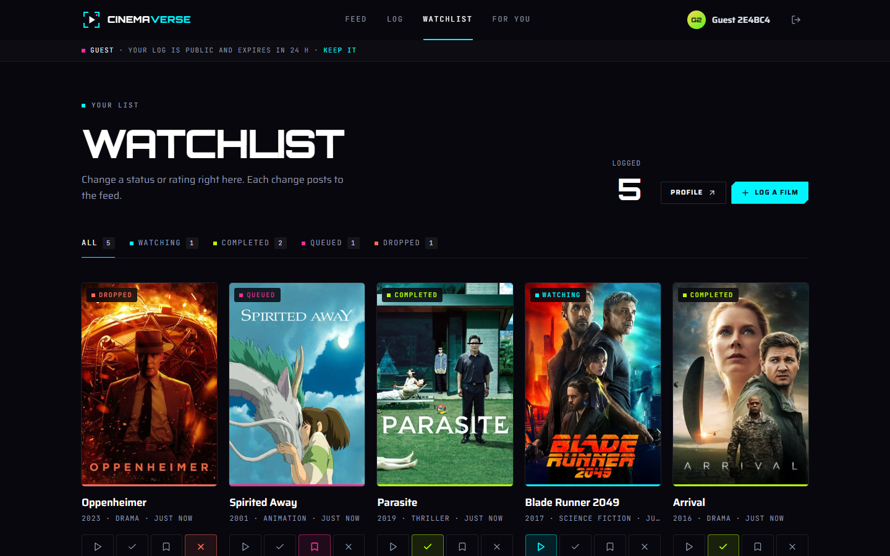
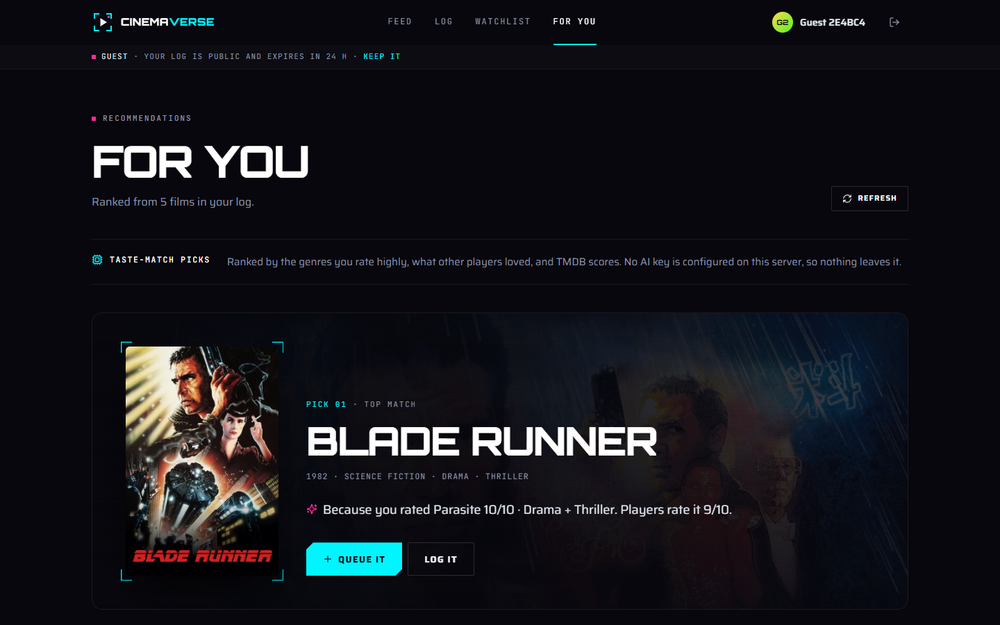
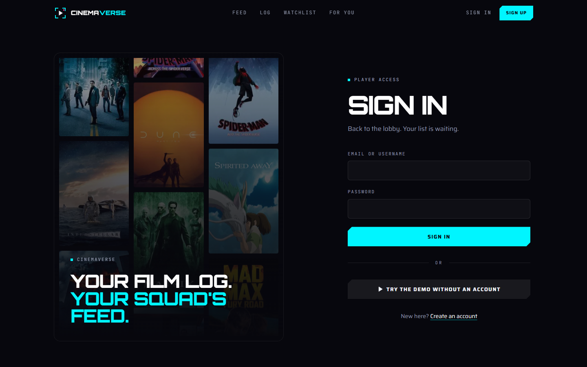
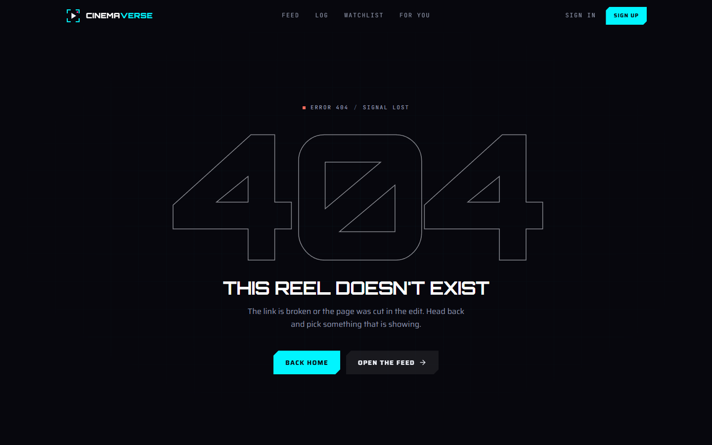

# CinemaVerse

A social film log with a gamer HUD look. Search TMDB, mark a film **watching / completed / queued / dropped**, rate it out of ten, add a short take, and it lands on your watchlist, your public profile and the shared squad feed. "For you" recommends what to watch next, using OpenRouter when a key is set and a built-in taste-match engine when it isn't.

**Live (previous version):** [cinemaverse-solo.netlify.app](https://cinemaverse-solo.netlify.app). The `revamp` branch has not been deployed yet.

| Home | Feed | Public profile |
|---|---|---|
|  |  |  |
| **Log a film** | **Watchlist** | **For you** |
|  |  |  |
| **Sign in** | **404** | |
|  |  | |

Phone (390 px): [feed](revamp-shots/09-phone-feed.png) · [log composer sheet](revamp-shots/10-phone-log.png)

## Design

A HUD for a film log: the neon-on-void palette and Orbitron stay, but each is used for one job.

- **Type.** Orbitron for display and numerals only (page titles, ranks, stats). Saira for reading. JetBrains Mono for HUD readouts: labels, timestamps, statuses, counts. All three are self-hosted latin subsets in `public/fonts` (85 KB together, preloaded), sizes follow a fluid `clamp()` scale in `src/index.css`.
- **Colour has meaning.** Cyan is action and focus, and the four statuses keep their own colours (cyan watching, lime completed, pink queued, coral dropped) everywhere: poster base lines, chips, tabs, the profile split bar.
- **Posters lead.** Feed entries, shelves, the watchlist, picks and the home rail are built around the poster. Corner brackets "lock on" to whatever you hover or select.
- **Motion.** A boot screen until the app paints, a scan line and settle on every route change, scroll reveals, a crossfading hero and a live ticker. All of it is off under `prefers-reduced-motion`.
- **Phone.** A thumb-reach tab bar with the logger in the middle, and the composer opens as a bottom sheet.
- **States.** Loading skeletons match each layout; empty, error, no-results and 404 states share one framed design.

## Stack

- **Client:** React 18 + Vite 6 + Tailwind 3 + React Router (JSX).
- **API:** a single framework-free `(Request) => Response` handler in TypeScript (`server/`). It runs as a Netlify Function (`netlify/functions/api.mts`, path `/api/*`) in production and inside the Vite dev server locally, so there's one code path.
- **Database:** PostgreSQL. With `DATABASE_URL` set it uses `pg` (Neon, Supabase, RDS, local Postgres). Without it, it runs [PGlite](https://pglite.dev), which is Postgres 18 compiled to WASM, inside the Node process, so dev and tests need no Docker and no install. The SQL is the same for both.
- **Validation:** zod at every API boundary. **Tests:** Vitest (API, against a real in-memory Postgres) and Playwright (browser smoke).
- **External services, both optional:** TMDB (film data, proxied so the key stays on the server) and OpenRouter (AI picks).

## Run it locally

Needs Node 22.18 or newer (scripts use Node's built-in TypeScript support).

```bash
npm install
npm run dev          # http://localhost:4410
```

That's all. On first start the embedded database is created in `.data/pglite`, migrated, and seeded with the demo community. No keys are required:

- With no `TMDB_API_KEY`, trending and search use a bundled catalogue of 40 real TMDB films, labelled "Offline catalog" in the UI. To use live TMDB data without a key of your own, set `TMDB_UPSTREAM=https://cinemaverse-solo.netlify.app` and requests go through that deployment's proxy.
- With no `OPENROUTER_API_KEY`, "For you" uses taste-match and says so on the page.

Copy `.env.example` to `.env` to set any of these. `.env` is git-ignored.

### Demo accounts

| Who | How | Notes |
|---|---|---|
| **Guest** | "Try the demo" button (home, feed, sign-in page) | Instant account with no email or password. Expires after 24 hours, along with its posts. |
| **Six demo players** (`nova`, `pixel_rat`, `cinema_ghost`, `reel_ronin`, `kaiju_kid`, `velvet_static`) | Seeded | Fictional and labelled **DEMO** everywhere. They have no password and can't be signed into. Their logs fill the feed, profiles and the recommendation pool. |
| **Your own account** | Sign up | Username, email, password (8+ characters). |
| **Admin** | Sign up with an email listed in `ADMIN_EMAILS` | Can delete any feed post. Everyone else can delete only their own. |

### Scripts

| Command | What it does |
|---|---|
| `npm run dev` | Vite + API + embedded Postgres on port 4410 |
| `npm run build` | Production client build into `dist/` |
| `npm run typecheck` | `tsc` over the API, shared code, scripts and tests |
| `npm test` | 51 Vitest tests: 41 API tests on an in-memory Postgres, 10 client unit tests |
| `npm run test:e2e` | 4 Playwright tests: the public flow, phone layout and composer sheet, the 404 and console errors. First run on a new machine: `npx playwright install chromium` |
| `npm run db:migrate` / `db:seed` | Apply migrations / add the demo community (uses `DATABASE_URL` if set) |
| `npm run db:reseed` | Re-time the demo community to "now" so the feed looks fresh |
| `npm run db:reset` | Embedded DB only: wipe and recreate |

## What needs real keys or accounts

| Variable | Without it | With it |
|---|---|---|
| `DATABASE_URL` | Local: embedded DB in `.data/pglite`. **On Netlify: an in-memory sandbox per function instance.** The seeded demo data always shows, but signups and logs don't persist and may not carry across instances. A banner says so. | Real persistence. Any Postgres works (Neon and Supabase have free tiers). Migrations and the demo seed run automatically on first request. |
| `TMDB_API_KEY` | Offline catalogue of 40 films | Live trending and full search. Set it in Netlify site env (server-side; never `VITE_`). |
| `OPENROUTER_API_KEY` (+ optional `OPENROUTER_MODEL`, default `openai/gpt-4o-mini`) | Taste-match recommendations | AI picks with a reason for each, matched to TMDB posters. Falls back to taste-match, with a notice, if the call fails, times out (15 s) or returns junk. |
| `ADMIN_EMAILS` | No admins | Listed emails get the admin role at sign-up |

## API

Every route declares its access level, and the router enforces it before the handler runs. All state-changing requests must send JSON (form posts are rejected with 415) and, when the browser sends an `Origin` header, it must match the host (403 otherwise).

| Method & path | Access | Purpose |
|---|---|---|
| `GET /api/health` | public | DB kind, sandbox flag, which keys are configured |
| `GET /api/auth/me` | public | Current user or `null` |
| `POST /api/auth/signup` · `/login` · `/demo` · `/logout` | public (rate-limited) | Session cookie auth |
| `GET /api/feed?status=&limit=&cursor=` | public | Keyset-paginated activity feed |
| `POST` / `DELETE /api/feed/:id/like` | user | Like / unlike (idempotent) |
| `DELETE /api/feed/:id` | owner or admin | Remove a post |
| `GET /api/watchlist?status=` | user | Your entries + per-status counts |
| `PUT /api/watchlist/:tmdbId` | user | Log or update a film (posts to the feed if something changed) |
| `PATCH` / `DELETE /api/watchlist/:tmdbId` | user | Edit status/rating/take, or remove. Scoped to your own rows. |
| `GET /api/users/:username` | public | Profile, stats, shelves, recent activity (never email, role or ids) |
| `PATCH /api/users/me` | user | Edit display name / bio |
| `GET /api/recommendations` | user | `{ source: 'openrouter' \| 'taste-match', notice, items[] }` |
| `GET /.netlify/functions/tmdb?path=` | public | TMDB proxy, allow-listed to the read-only endpoints the app uses |

### Security notes

- Passwords: scrypt (N=16384) with a per-user salt. Login does the same work for unknown users, so response timing doesn't reveal which accounts exist.
- Sessions: 32 random bytes in an `HttpOnly; SameSite=Lax` cookie (`Secure` over HTTPS). Only the SHA-256 of the token is stored. Logout deletes the row.
- Auth routes are rate-limited per IP and per identifier. The limit is in-memory, per instance.
- Watchlist queries are always scoped by the session user's id, and tests cover cross-user access.
- The TMDB proxy used to forward any path the browser asked for, using the site's key. It now allows only an explicit list of endpoints and parameters.

## Deploying to Netlify (not done yet)

1. Add env vars in Site settings: `TMDB_API_KEY` (already set on the current site), and ideally `DATABASE_URL`. Optional: `OPENROUTER_API_KEY`, `ADMIN_EMAILS`.
2. Deploy the `revamp` branch as a **deploy preview** first. `netlify.toml` sets Node 22, the esbuild bundler, and ships `@electric-sql/pglite` and `pg` as external modules.
3. On the preview, check that `/api/health` returns `ok: true` and that `/api/*` reaches the function rather than the SPA fallback.
4. Link previews use `og:image` = `https://cinemaverse-solo.netlify.app/og.jpg` (in `index.html`). Change that URL if the site moves to another domain.

Not yet verified on Netlify itself: the `/api/*` function path working alongside the `/*` SPA redirect, and PGlite's WASM loading inside a Netlify Function (only needed when `DATABASE_URL` is unset). Everything else was verified locally on Windows 11 / Node 24.

## Layout

```
server/            API: app.ts (router + handler), auth, validation, routes/, services/recommend.ts, tmdb.ts
server/db/         driver adapter (pg | PGlite), migrations, demo seed
shared/            constants + offline film catalogue, imported by both client and server
netlify/functions/ api.mts (/api/*), tmdb.mts (TMDB proxy)
src/               React client: pages/, components/, context/, hooks/, lib/
tests/api/         Vitest API tests        tests/unit/  client unit tests        tests/e2e/   Playwright
scripts/db.ts      migrate / seed / reseed / reset
archive/wasp-v1/   the original Wasp + Prisma version, kept for reference (not built)
```

## Known shortcuts

- Film metadata on a log (title, poster, genres) comes from the client. It is validated (including TMDB image-path format) but not re-fetched from TMDB on the server.
- The rate limiter and the recommendation cache live in memory per instance.
- Recommendations cover films only. TV tracking from the Wasp version is not carried over.

Film data and images from [TMDB](https://www.themoviedb.org/). This product uses the TMDB API but is not endorsed or certified by TMDB.
